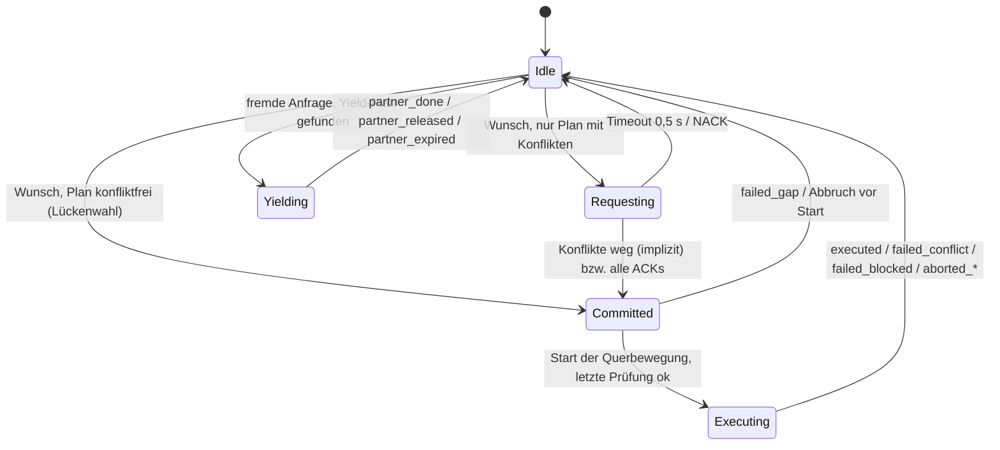

# MCM-Service (Maneuver Coordination Service)

Dieses Dokument fasst den Maneuver Coordination Service in `src/artery/mcm` zusammen: was er tut, wie er aufgebaut ist und welche Entwurfsentscheidungen dahinterstehen. Der Service ist die ehrliche Grundlage der Masterarbeit, also das Referenzverhalten, gegen das später Angreifervarianten und die Erkennung von Fehlverhalten (Misbehavior Detection) auf Trajektorien laufen.

Stand: 19.10.2026

---

## 1. Überblick

- **Konzept:** ETSI TR 103 578 V2.1.1, Konzept A1 („agreement seeking“, Abschnitt 5.2.2).
  - Jede MCM enthält die **Referenztrajektorie**, also den aktuellen Plan des Senders.
  - Wer für einen Spurwechsel Hilfe braucht, hängt eine **angefragte Trajektorie** (requested trajectory) an. Die Anfrage richtet sich an niemanden bestimmten.
  - Fahrzeuge, deren Plan mit der Anfrage in Konflikt steht, geben nach (**Yield**) und senden eine angepasste Referenztrajektorie. Das ist die **implizite Zusage**.
  - Optional gibt es die Erweiterung mit explizitem ACK/NACK (`explicitResponses`).
- **Spurwechsel:** SUMO entscheidet keine Spurwechsel selbst (`laneChangeMode = 256`). Jeder Spurwechselwunsch von SUMOs Spurwechselmodell wird zu einem Manöver dieses Services. Die Querbewegung steuert der Service selbst über das Sublane-Modell (`changeSublane` in jedem Schritt). Das Profil ist S-förmig (quintisch), die Dauer wird pro Spurwechsel gezogen, und ein Abbruch ist jederzeit möglich.
- **Teilnehmer:** Ein Fahrzeug ist entweder ein kooperierender MCM-Teilnehmer (CA + `McService`) oder sendet überhaupt keine V2X-Nachrichten. Eine Kategorie „vernetzt, gibt aber nie nach“ gibt es bewusst nicht mehr. Fahrzeuge ohne MCM nimmt ein `artery.envmod.Car` über seine Radarsensoren wahr.

## 2. Dateien

| Datei | Inhalt |
|---|---|
| `Mcm.msg` | Nachrichtenformat (vereinfachte MCM, kein ASN.1) |
| `BaseMcService.{h,cc,ned}` | gesamte Logik: Senden, Empfangen, Requester, Yielder, Konfliktprüfung, Querregelung, Logs |
| `McService.{h,cc,ned}` | ehrlicher Service: legitime Abbrüche von Spurwechseln (Variante A angekündigt, B still) |
| `McTrajectoryPlanner.{h,cc}` | Pläne (Pfad + Längs- + Querprofil) aus dem SUMO-Zustand, Abtastung, Footprints |
| `McGeometry.{h,cc}` | lokale Tangentialebene (ENU), Trajektorien-Interpolation, Konfliktregel `conflicts()` |
| `McLog.{h,cc}` | CSV-Logs (`stations`, `maneuvers`, `requests`, `mcm-tx`) |

## 3. Nachricht (`Mcm.msg`)

| Teil | Felder |
|---|---|
| Header | `stationId`, `generationDeltaTime` (ms, TAI mod 65536 wie bei der CAM) |
| Basiscontainer | Position (0,1 µ°), Kurs (0,1°), Geschwindigkeit (0,01 m/s), Länge, Breite; Bezugspunkt ist die Mitte der Frontstoßstange |
| Referenztrajektorie | `referenceId` (neu bei jedem neuen Plan), `referenceType`, 32 Punkte |
| angefragte Trajektorie | nur wenn `requestedId != 0`: `requestedType`, Punkte |
| explizite Antworten | `McResponse`: `stationId`, `trajectoryId`, `accept`, `reason` (`ACCEPT`, `BUSY`, `COST`) |

- **Trajektorienpunkte:** `timeOffset` in ms, `deltaEast` und `deltaNorth` in cm relativ zur Position im Basiscontainer, `speed`, `heading`. Der Abstand ist 250 ms, der Horizont 8 s (32 Punkte). Der Empfänger braucht keine Karte.
- **Manövertypen:** `KEEP_LANE`, `LANE_CHANGE_LEFT`, `LANE_CHANGE_RIGHT`, `MERGE` (aus einer endenden Spur, z. B. einer Einfädelspur), `YIELD`.
- **Länge auf der Leitung:** Sie wird explizit gesetzt (`headerBytes`, `pointBytes`, `requestHeaderBytes`, `responseBytes`).

## 4. Zustandsautomat



Nach jedem eigenen Manöver gilt eine Pause (`maneuverCooldown`, 2 s). Ein Wunsch von SUMO muss `wishPersistence` (0,5 s) lang bestehen. Die berücksichtigten Gründe sind strategisch, Geschwindigkeitsgewinn und Rechtsfahren (`wishReasons`).

## 5. Senden

Eine MCM geht raus, wenn eine dieser Bedingungen zutrifft:

- Der Plan ändert sich (`mSendNow`).
- Das Fahrzeug weicht von der zuletzt gesendeten Referenztrajektorie ab: längs mehr als 1 m, quer mehr als 0,25 m oder mehr als 0,5 m/s Geschwindigkeit.
- `maxInterval` (1 s) ist vergangen.
- Während einer Anfrage wird alle `requestRepeatInterval` (0,1 s) wiederholt.

Dabei gilt `minInterval` (0,1 s) als Mindestabstand. Bei einem stillen Abbruch schweigt der Sender, bis seine letzte Trajektorie abgelaufen ist.

## 6. Requester: eigener Spurwechsel

1. **Wunsch übernehmen.** Kommt der Wunsch aus einer endenden Spur und ist strategisch, wird er zum Typ `MERGE`.
2. **Lückenwahl** (`startManeuver`). Kandidaten sind Kombinationen aus:
   - Geschwindigkeitsänderung in Schritten von `requesterSpeedStep` (2 m/s) bis `maxRequesterSpeedChange` (±4 m/s), mit `requesterDeceleration` (1,5 m/s²) bzw. `requesterAcceleration` (1 m/s²). Nach oben begrenzt ist sie durch das Tempolimit der Spur, mindestens aber durch die eigene Wunschgeschwindigkeit (`accelerationLimit`). Ein Fahrzeug darf seine Wunschgeschwindigkeit für ein Manöver also kurz überschreiten;
   - Vorlaufzeit `leadTime` (1 s) plus 0, 1 oder 2 s (`maxExtraLeadTime`), solange Vorlauf und gezogene Spurwechseldauer in den 8-s-Horizont passen.

   Verglichen wird jeder Kandidat mit „Spur halten mit derselben Geschwindigkeitsänderung“. Es zählen also nur Konflikte, die die Querbewegung verursacht; ein Folgefahrzeug in der eigenen Spur passt sich einer Verzögerung an wie jedem anderen Bremsen. Ein beschleunigender Kandidat darf dagegen in der eigenen Spur mit niemandem vor ihm in Konflikt geraten.

   Die Kandidaten werden nach Aufwand sortiert: ein Geschwindigkeitsschritt zählt wie 1 s zusätzlicher Vorlauf, bei Gleichstand kommt Bremsen vor Beschleunigen. Bei einem Merge muss die Spurgrenze vor dem Ende der Einfädelspur überquert werden, sonst fällt der Kandidat weg (außer der Grundplan ohne Änderung).
   - Der erste Kandidat, der **mit Entscheidungsmarge** konfliktfrei ist (siehe Abschnitt 8), wird ohne Verhandlung sofort zur Referenztrajektorie (`Committed`). Ein Kandidat, der nur mit den normalen Regeln konfliktfrei ist, wird angefragt, weil ihn die kleinste Abweichung anderer sonst während der Querbewegung abbrechen lässt.
   - Gibt es keinen, wird der Kandidat **angefragt**, der am wenigsten Kooperation braucht: zuerst ohne Blockade durch ein Fahrzeug ohne MCM, dann mit möglichst wenigen betroffenen MCM-Fahrzeugen.
3. **Längsführung.** Eine gewählte Geschwindigkeitsänderung fährt das Fahrzeug ab der Ankündigung, also schon während der Anfrage. Die Regelung schließt in jedem Schritt die Schleife: `setSpeed` auf die Geschwindigkeit des nächsten Schritts. Die Referenztrajektorie während der Anfrage ist „Spur halten mit dieser Geschwindigkeitsänderung“. Ohne Änderung wird die Geschwindigkeit konstant gehalten (Kap. 5.2). Nach dem Manöver übernimmt SUMO wieder.
4. **Anfrage** (`Requesting`). In jedem Schritt prüft der Requester seinen Plan gegen die empfangenen Referenztrajektorien und gegen wahrgenommene Fahrzeuge ohne MCM.
   - Konfliktfrei mit **halber** Entscheidungsmarge heißt implizit zugesagt, das Manöver geht nach `Committed`.
   - Bei `explicitResponses` sind zusätzlich ACKs aller Betroffenen nötig, ein NACK beendet die Anfrage sofort.
   - Nach `requestTimeout` (0,5 s) wird die Anfrage zurückgezogen.
5. **Letzte Prüfung vor dem Start der Querbewegung.** Gibt es jetzt einen Konflikt, endet das Manöver mit `failed_gap`. Hier entscheidet auch `decideExecution()`, ob und wie weit gefahren wird.
6. **Ausführung** (`Executing`): Die Querregelung arbeitet mit `changeSublane`, 0,1 s Vorausschau. Bis die Spurgrenze überquert ist, wird laufend weiter auf Konflikte geprüft. Bei einem Konflikt gibt es eine angekündigte Rückkehr (`failed_conflict`). Hängt das Fahrzeug mehr als 0,5 m hinter dem Plan zurück und das länger als 0,3 s (SUMO verweigert die Bewegung), folgt eine Rückkehr mit `failed_blocked`. Die Rückkehr wird mit konstanter Geschwindigkeit gefahren.

**Vorrang:** Eine frühere Anfrage eines anderen Fahrzeugs hat Vorrang (TR, Abschnitt 5.2.3). Bei Gleichstand gewinnt die kleinere Station-ID.

## 7. Yielder: Nachgeben für fremde Anfragen

1. **Bin ich betroffen?** Nur wenn der Partner innerhalb von `requestRange` (200 m) ist und die angefragte Trajektorie mit dem eigenen Plan in Konflikt steht, ohne dass die Referenztrajektorie des Requesters das auch tut. Sonst wird bei der nächsten Wiederholung der Anfrage erneut geprüft.
2. **Ablehnen,** wenn das Fahrzeug nicht `Idle` ist (eigenes Manöver oder schon am Nachgeben) → `busy`.
3. **Yield-Plan suchen** (`findYieldPlan`): Die Kandidaten sind nach steigendem Aufwand geordnet:
   - zuerst der kleinste Geschwindigkeitsverlust gegenüber der Geschwindigkeit des Requesters, in Schritten von 1 m/s bis `maxYieldSpeedLoss` (5 m/s);
   - innerhalb davon die kleinste Verzögerung (0,5 bis 3 m/s²) oder Beschleunigung (0,5 bis 1 m/s², `maxYieldAcceleration`, bis höchstens `accelerationLimit`).

   Ein beschleunigender Plan darf außer mit dem Requester mit niemandem in Konflikt geraten, z. B. nicht mit dem eigenen Vorderfahrzeug (`freeAhead`). Gibt es keinen passenden Plan → `cost`.
4. **Hysterese:** Der Yielder prüft „betroffen“ und den Yield-Plan mit der vollen Entscheidungsmarge, der Requester die Zusage nur mit der halben (Abschnitt 8). Grund: Beide kennen sich nur aus der letzten MCM (Alter, Stützpunkte im Abstand von 250 ms, gerundete Positionen). Ohne Reserve hatte der Yielder die kleinste gerade ausreichende Verzögerung gewählt, und die Prüfung des Requesters ist trotzdem gescheitert. Vorher führte keine Zusage zu einem Spurwechsel, danach rund ein Drittel; die übrigen scheitern an anderen Partnern oder an Fahrzeugen ohne MCM.
5. **Ausführung:** `slowDown` auf die Zielgeschwindigkeit, danach `setSpeed` halten. Die Referenztrajektorie ist vom Typ `YIELD`. Das Nachgeben endet, sobald der Requester weder anfragt noch das Manöver fährt. War das Manöver schon zugesagt, ist das Ergebnis `partner_done`, sonst `partner_released`. Spätestens endet es, wenn der Horizont der Anfrage abgelaufen ist (`partner_expired`).

## 8. Konfliktprüfung

- **Körper:** Mitte der Frontstoßstange, Länge entgegen dem Kurs, Breite. Abgetastet wird alle `checkStep` (0,25 s) bis zum Ende des Spurwechsels plus 1 s, höchstens 8 s.
- **Konflikt** (`mcm::conflicts`), beurteilt entlang des Kurses des Requesters: Die Fahrzeuge überlappen sich seitlich (plus `conflictLateralMargin`, 0,3 m), und die Längslücke ist kleiner als `conflictMinGap` (2,5 m) + `conflictHeadway` (1 s) × Geschwindigkeit des Folgenden. Eine Überlappung in Längsrichtung ist immer ein Konflikt.
- **Nur durch das Manöver verursachte Konflikte zählen:** Ein Zeitpunkt zählt nur, wenn der Manöverplan in Konflikt steht, der Plan „Spur halten“ dagegen nicht. Normales Folgefahren erzeugt also keine Anfrage.
- **Fremde Trajektorien:** Sie werden linear zwischen den Punkten interpoliert und nach dem Horizont mit konstanter Geschwindigkeit extrapoliert. Nachbarn, die länger als `neighbourTimeout` (1,5 s) still sind, werden verworfen.
- **Fahrzeuge ohne MCM:** Sie kommen aus dem Umgebungsmodell, mit konstanter Geschwindigkeit vorhergesagt. Ein Radarobjekt, das weniger als 3 m von der aktuellen Position eines MCM-Nachbarn entfernt ist, gilt als dieser Nachbar. Ein Konflikt mit einem solchen Fahrzeug setzt `blockedByUnknown`, und kein MCM-Partner kann ihn auflösen.

### Hysterese: drei Stufen

Jede Seite kennt die andere nur aus deren letzter MCM. Würden alle Prüfungen mit denselben Regeln laufen, entschiede jede kleine Abweichung zufällig über das Ergebnis. Deshalb gibt es drei Stufen, festgelegt über `decisionMarginGap` (2 m) und `decisionMarginHeadway` (0,5 s):

| Stufe | Regeln | wo |
|---|---|---|
| Entscheidung | normal + volle Marge (`mDecisionRules`) | Yielder: „bin ich betroffen?“, Wahl des Yield-Plans, Prüfung „frei voraus“ beim Beschleunigen; Requester: Spurwechsel ohne Verhandlung übernehmen, Beschleunigen in der eigenen Spur |
| Zusage | normal + halbe Marge (`mGrantRules`) | Requester: implizite Zusage während der Anfrage |
| Überwachung | normal (`mConflictRules`) | letzte Prüfung vor dem Start, laufende Prüfung bis zur Spurgrenze |

Der Vergleichsplan „Spur halten“ wird immer mit den normalen Regeln geprüft.

## 9. Legitime Abweichungen (`McService`, Kap. 5.3)

- **Abbruch:** Mit `abortProbability` wird ein zugesagter Spurwechsel abgebrochen. Der Zeitpunkt ist `abortProgress` × Spurwechseldauer, Voreinstellung uniform(0; 0,5); bei 0 wird die Querbewegung gar nicht erst gestartet.
  - Variante A (`abortAnnounced = true`): Die Rückkehr wird mit neuer Referenztrajektorie angekündigt.
  - Variante B: still, keine MCM, bis die letzte Trajektorie abgelaufen ist.
- Ein Merge aus einer endenden Spur wird nie abgebrochen.
- `dropProbability`: zusätzlicher Verlust empfangener MCMs zum Kanal.

## 10. Hooks für Angreifervarianten

| Hook | Zweck |
|---|---|
| `decideExecution(const Maneuver&)` | ob und wie weit ein zugesagter Spurwechsel gefahren wird, angekündigt oder still |
| `beforeSend(McMessage&)` | letzte Änderung einer MCM vor dem Senden (z. B. gefälschte Trajektorien) |

Angreifer leiten von `BaseMcService` oder `McService` ab. Der Detektor bekommt empfangene MCMs über das Signal `McmReceived`, also nach dem simulierten Verlust.

## 11. Parameter (Auswahl, `BaseMcService.ned`)

| Parameter | Voreinstellung | Bedeutung |
|---|---|---|
| `numPoints`, `pointSpacing` | 32, 0,25 s | Trajektorie mit 8 s Horizont |
| `leadTime` | 1 s | Spur halten vor der Querbewegung |
| `laneChangeDuration` | uniform(3 s, 6 s) | pro Spurwechsel gezogen |
| `lateralShape` | quintic | linear, sinusoidal oder quintic |
| `returnDuration` | 2 s | Rückkehr nach einem Abbruch |
| `requestTimeout` | 0,5 s | darf `leadTime` nicht überschreiten |
| `maneuverCooldown`, `wishPersistence` | 2 s, 0,5 s | Takt der Versuche (≈ 3 s) |
| `requesterAcceleration`, `requesterDeceleration` | 1 bzw. 1,5 m/s² | Lückenwahl |
| `maxRequesterSpeedChange`, `requesterSpeedStep` | 4 m/s, 2 m/s | Lückenwahl |
| `maxExtraLeadTime` | 2 s | Lückenwahl, in Schritten von 1 s |
| `explicitResponses` | false | ACK/NACK-Erweiterung |
| `requestRange` | 200 m | Reichweite der Konfliktprüfung |
| `conflictMinGap`, `conflictHeadway`, `conflictLateralMargin` | 2,5 m, 1 s, 0,3 m | Konfliktregel |
| `decisionMarginGap`, `decisionMarginHeadway` | 2 m, 0,5 s | Hysterese (Entscheidung volle, Zusage halbe Marge) |
| `maxYieldDeceleration`, `maxYieldAcceleration`, `maxYieldSpeedLoss` | 3 m/s², 1 m/s², 5 m/s | Grenzen des Nachgebens |
| `usePerception` | true | Fahrzeuge ohne MCM über Sensoren |
| `dropProbability` | 0 | zusätzlicher Empfangsverlust |
| `logPrefix`, `logTransmissions` | "", true | CSV-Logs |
| `visualizeTrajectory` | false | Pfeile in sumo-gui |

## 12. Logs (`<config>-<run>-*.csv` in `results/`)

Alle Dateien außer `mcm-tx.csv` werden zeilenweise geschrieben, man kann sie also schon während des Laufs lesen. `mcm-tx.csv` wird gepuffert und ist erst nach Ende des Laufs vollständig.

| Datei | eine Zeile pro | wichtigste Spalten |
|---|---|---|
| `stations.csv` | Station | Station-ID, SUMO-ID, Service-Typ (Ground Truth für Angreifer) |
| `maneuvers.csv` | Manöver (Requester) oder Nachgeben (Yielder) | `partners`, Zeitpunkte, `outcome`, ACKs/NACKs, Spurwechseldauer, Abbruchzeit, `unknown_start`, `conflicts_end`, `unknown_end`, `speed_change` |
| `requests.csv` | Entscheidung eines betroffenen Partners | `decision` (`accepted`, `busy`, `cost`), Zustand, Abstand, Lücke längs/quer, beide Geschwindigkeiten, Yield-Ziel und Beschleunigung |
| `mcm-tx.csv` | gesendete MCM | Zustand, IDs und Typen, Basiscontainer, Bytes, beide Trajektorien, Antworten |

**Werte von `outcome`:**
- Requester: `executed`, `timeout`, `declined`, `failed_gap`, `failed_conflict`, `failed_blocked`, `aborted_announced`, `aborted_silent`, `unfinished`
- Yielder: `partner_done`, `partner_released`, `partner_expired`, `unfinished`

Skalare in den `.sca`-Dateien: `mcmSent`, `mcmSentWithRequest`, `mcmSentResponses`, `mcmReceived`, `mcmDropped`, `requestsAccepted`, `requestsDeclinedBusy`, `requestsDeclinedCost`.

`scenarios/*/analysis/announcement_error.py` vergleicht die angekündigten mit den gefahrenen Trajektorien (FCD aus der Konfiguration `ground-truth`). Das ist das Grundrauschen für den Detektor.

## 13. Szenarien

| Szenario | Straße | Verkehr |
|---|---|---|
| `mcm-highway` | 4 km, 3 Spuren, Einfädelspur 300 m | alle Fahrzeuge automatisiert und mit MCM, ohne Lkw |
| `mcm-twolane` | 4 km, 2 Spuren, Einfädelspur 300 m | ca. 60 % `coop_*` (MCM), 26 % `manual_*` (ohne V2X, `sigma=0.5`), 13 % `truck_*` (ohne V2X, 80 km/h); Radarwahrnehmung (`sensors.xml`) |

Die Konfigurationen in beiden Szenarien sind `General`, `sumo-gui`, `ground-truth`, `density`, `negotiation` und `legitimate-deviations`, in `mcm-highway` zusätzlich `lane-change-duration`.

## 14. Arbeitsablauf

- **Bauen und starten:** Nur in der Ubuntu-VM (UTM). Auf dem Mac gibt es kein OMNeT++. Synchronisiert wird über git: auf dem Mac `./push_all.sh "Nachricht"`, in der VM `./pull_all.sh`.
- **Starten:**

  ```bash
  ./run_scenario.sh mcm-twolane sumo-gui
  ```

  Das Skript baut vorher selbst.
- **SUMO-Mechanik ausprobieren:** Das geht auf dem Mac mit Python-TraCI (SUMO 1.27).

## 15. Entwurfsentscheidungen und Verlauf

- **TR-konform, Konzept A1:** Statt Anfragen an einen festen Partner gibt es die Referenztrajektorie in jeder MCM, eine angefragte Trajektorie ohne Adressaten und die implizite Zusage. ACK/NACK lässt sich zuschalten.
- **Realistische Spurwechsel:** 3–6 s, quintisch, 8 s Horizont, laufende Konfliktprüfung bis zur Spurgrenze, jederzeit abbrechbar.
- **Keine Kategorie „noncoop“ mehr:** Entweder kooperierender Teilnehmer oder ganz ohne V2X. Der frühere Anteil von noncoop ist in `mcm-twolane` an coop gegangen.
- **Hysterese beim Yielder:** Implizite Zusagen kommen jetzt an (siehe Abschnitt 7).
- **Hysterese auch beim Requester:** Nach der Lückenwahl starteten viele Spurwechsel ohne Verhandlung und brachen dann mit `failed_conflict` ab, z. B. 2652 viermal wegen 2728. Der Grund war der erste, gerade so konfliktfreie Kandidat, während das Fahrzeug in der Zielspur leicht beschleunigte. Seitdem entscheidet der Requester mit voller Marge, nimmt Zusagen mit halber Marge an und bricht nur bei echten Konflikten ab. Die Parameter `yieldMargin*` heißen jetzt `decisionMargin*`. Noch nicht in der VM getestet.
- **Lückenwahl beim Requester und leichtes Beschleunigen beim Yielder:** Das löst Fälle, in denen der Partner vor dem Requester fährt und Bremsen nicht hilft. Im ersten Lauf führten deutlich mehr Zusagen zu einem Spurwechsel (rund 19 `partner_done` gegenüber 14 `partner_released`), und es gab Spurwechsel ohne Verhandlung dank Geschwindigkeitsänderung.
- **Korrekturen nach dem ersten Lauf der Lückenwahl:**
  - Die Geschwindigkeitsgrenze war `getAllowedSpeed`. Weil das den Geschwindigkeitsfaktor enthält, ist es die Wunschgeschwindigkeit, und ein Yielder konnte praktisch nie beschleunigen. Jetzt gilt das Tempolimit der Spur.
  - Ein verzögernder Kandidat galt als Konflikt mit dem eigenen Folgefahrzeug. Jetzt wird mit „Spur halten mit derselben Geschwindigkeitsänderung“ verglichen, auch bei den Prüfungen während der Anfrage und vor dem Start.

## 16. Bekannte Grenzen und offene Punkte

- **Zugesagte Manöver anderer werden nicht respektiert:** Ein MCM-Fahrzeug reagiert nur auf angefragte Trajektorien. Ein schon zugesagter Spurwechsel in seine Spur (Referenztrajektorie eines Nachbarn) hält es nicht davon ab, in die Lücke zu beschleunigen, denn es wird von SUMO gefahren. Nach TR 103 578 sollten zugesagte Manöver respektiert werden. Idee: die eigene Geschwindigkeit so begrenzen, dass kein Konflikt mit den Referenztrajektorien anderer entsteht.
- **Alles oder nichts:** Gibt ein Partner nach, während ein anderer ablehnt, bremst der erste umsonst. Der Requester bekommt trotzdem den Timeout.
- **Fahrzeuge ohne MCM:** Blockiert nur so ein Fahrzeug, wird trotzdem alle ~3 s neu angefragt. Ideen: keine Anfrage senden, sondern warten bzw. die Geschwindigkeit anpassen, mit eigenem Ergebnis `blocked_unknown`.
- **Keine Dringlichkeit beim Einfädeln:** Für Merges gelten dieselben Grenzen beim Nachgeben und derselbe Takt der Versuche wie bei freiwilligen Spurwechseln. Idee: die Grenzen nach der Restlänge der Einfädelspur skalieren und den Takt verkürzen.
- **`partner_done` ist zu optimistisch:** Der Yielder meldet es schon, wenn der Requester das Manöver zusagt, auch wenn der Spurwechsel danach mit `failed_gap` scheitert. Sauberer wäre ein eigenes `partner_failed`.
- **Ein Partner pro Anfrage, eine Bewertung:** Eine einmal abgelehnte Anfrage (dieselbe ID) wird nicht neu bewertet. Der Requester fragt nach Timeout und Pause mit neuer ID an.
- **Geschwindigkeitsverlust beim Yielder:** Er ist nur relativ zur Geschwindigkeit des Requesters begrenzt. Ein schneller Yielder kann deshalb stark abbremsen, z. B. von 150 auf 85 km/h für einen Lkw-Überholer. Eine zusätzliche Grenze relativ zur eigenen Geschwindigkeit wäre denkbar.
- **Geschwindigkeit bei einer Anfrage:** Eine Geschwindigkeitsänderung aus der Lückenwahl läuft schon während der Anfrage. Bei einem Timeout gibt der Service die Geschwindigkeit wieder frei, das kann kleine Geschwindigkeitsschwankungen erzeugen.
